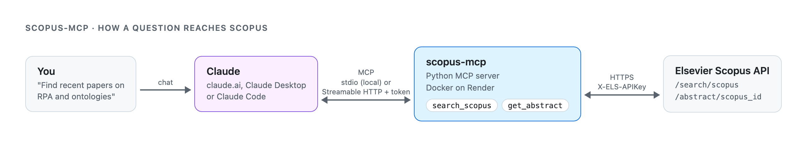

# scopus-mcp

**An MCP server that lets Claude search the Scopus research database and read abstracts.** It runs locally over stdio, or as a hosted HTTP endpoint (Docker on Render) protected by a bearer token.

<picture>
  <source media="(prefers-color-scheme: dark)" srcset="docs/images/architecture-dark.png">
  
</picture>

## Background

A literature search usually means switching between an AI assistant and the Scopus web interface, copying search strings in one direction and results in the other. Asking a language model for sources directly is risky: it can produce references that look right but don't exist.

## Idea

The [Model Context Protocol](https://modelcontextprotocol.io) (MCP) lets an AI assistant call external tools. scopus-mcp gives Claude two such tools on top of Elsevier's [Scopus Search and Abstract Retrieval APIs](https://dev.elsevier.com/). Claude can then build a Scopus query from a question asked in plain language, run it, read the abstracts of the promising hits and answer with real publications that have a Scopus ID and DOI. The API key stays on the server and is never given to the model.

## Tools

| Tool | What it does |
|---|---|
| `search_scopus(query, count=10)` | Runs a [Scopus search query](https://dev.elsevier.com/sc_search_tips.html) (e.g. `TITLE-ABS-KEY(...)`) and returns up to 25 hits with title, year, first author, Scopus ID, DOI and citation count |
| `get_abstract(scopus_id)` | Fetches the title, DOI and abstract of one publication |

## Example

A real `search_scopus` call with `TITLE-ABS-KEY("robotic process automation" AND ontology)` and `count=5`:

```text
- Developing RPA UI Interaction Patterns to Guide Bot Design (2027) — Wang Z.
  Scopus ID: 105053724694 | DOI: 10.1007/978-3-032-37777-7_45 | Cited by: 0
- From technology to strategy: The role of hyper-automation and artificial intelligence in end-to-end digital transformation (2026) — Sobczak A.
  Scopus ID: 105038154712 | DOI: 10.4324/9781003667773-1 | Cited by: 0
- Democratizing Robotic Process Mining: A Conceptual Framework for User Actions, Tasks, and RPA Bots (2024) — Hohenadl T.
  Scopus ID: 85203583886 | DOI: 10.1007/978-3-031-70445-1_12 | Cited by: 3
- Ontology based autonomous robot task processing framework (2024) — Ge Y.
  Scopus ID: 85193472861 | DOI: 10.3389/fnbot.2024.1401075 | Cited by: 15
- Security Ontology OntoSecRPA for Robotic Process Automation Domain (2023) — Kurylets A.
  Scopus ID: 85159282086 | DOI: 10.3390/app13095568 | Cited by: 12
```

Claude can then call `get_abstract("85159282086")` to read one of them before citing it.

## Running it

You need Python 3.12, [uv](https://docs.astral.sh/uv/) and a Scopus API key from the [Elsevier Developer Portal](https://dev.elsevier.com/). Full Scopus results need institutional access, for example through a university network.

```bash
git clone https://github.com/eeroklen-lang/scopus-mcp.git
cd scopus-mcp
cp .env.example .env          # then set SCOPUS_API_KEY in .env
uv sync
```

### Locally, over stdio

**Claude Code:**

```bash
claude mcp add scopus -- uv --directory /path/to/scopus-mcp run scopus-mcp
```

**Claude Desktop** (`claude_desktop_config.json`):

```json
{
  "mcpServers": {
    "scopus": {
      "command": "uv",
      "args": ["--directory", "/path/to/scopus-mcp", "run", "scopus-mcp"]
    }
  }
}
```

`uv --directory` runs the server in the project folder, so it reads the API key from `.env`.

### Hosted, over HTTP

With `MCP_TRANSPORT=http`, the server serves MCP's Streamable HTTP transport at `/mcp` on `PORT` (default 8000). The included `Dockerfile` and `render.yaml` deploy it as a Docker web service on [Render](https://render.com): create a Blueprint from the repo and set `SCOPUS_API_KEY` and `MCP_AUTH_TOKEN` in the dashboard.

Clients then connect with the token as a bearer header, for example:

```bash
claude mcp add --transport http scopus https://<your-service>.onrender.com/mcp \
  --header "Authorization: Bearer <MCP_AUTH_TOKEN>"
```

| Variable | Purpose |
|---|---|
| `SCOPUS_API_KEY` | Elsevier API key (required) |
| `MCP_TRANSPORT` | `stdio` (default) or `http` |
| `MCP_AUTH_TOKEN` | Shared secret that HTTP clients must send as `Authorization: Bearer …`. If unset, the HTTP endpoint is open to anyone who knows the URL. |
| `PORT` | HTTP port (default `8000`; Render sets it) |

MCP's DNS-rebinding host check is turned off for the HTTP transport. That check protects browser-facing servers on `localhost`, and this endpoint is public and gated by the bearer token.

## Tech stack

Python 3.12 · [MCP Python SDK](https://github.com/modelcontextprotocol/python-sdk) · httpx · Starlette/Uvicorn · uv · Docker · Render
